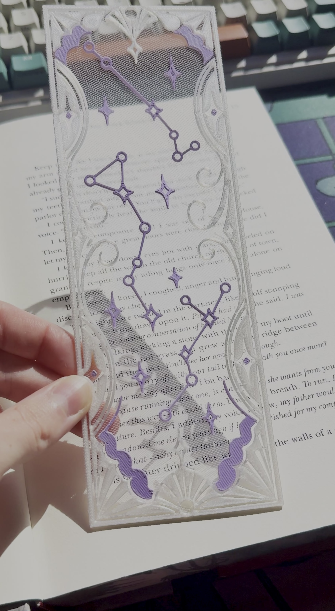
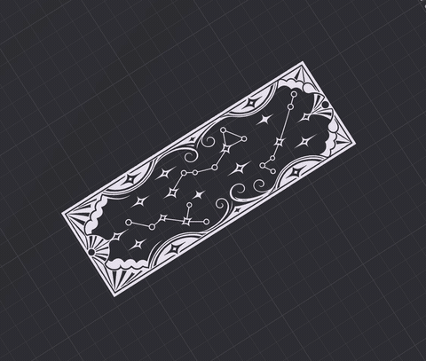

# 3D Printing on Fabric

Welcome to my collection of 3D printing experiments on fabric! I share my creative projects on [Crafts Experiments (@madebymarichka)](https://www.instagram.com/madebymarichka/) on Instagram.

This repository brings together the 3D models, photos, and project notes for my fabric printing experiments so you can try them yourself. Browse the projects below, or start with the [Guide to 3D Printing on Fabric](GUIDE.md).

## Models

### Bookmark

<table>
  <tr>
    <td valign="middle"></td>
    <td valign="middle"></td>
  </tr>
</table>

A celestial-inspired bookmark featuring stars, printed onto tulle. I started with a sketch on paper, then used an app to turn it into a `.3mf` file. In Bambu Studio, I adjusted the dimensions to create six layers of filament and added a pause after layer three. During the pause, I placed tulle over the printed base and secured it with magnets, then resumed printing to sandwich the fabric between the plastic layers.

- [Project video](https://www.instagram.com/reel/DeezNMwhL9o/)
- [Model files](models/bookmark/)

More models are in progress and will be posted soon! Follow [Crafts Experiments on Instagram](https://www.instagram.com/madebymarichka/) for sneak peeks and updates.

## Instructions

New to printing on fabric? Start with the [Guide to 3D Printing on Fabric](GUIDE.md) for materials, setup, printing steps, and troubleshooting tips.

## Notes

Printing results can vary depending on the fabric, printer, filament, and settings. Check each project’s notes for details and tips.

## License

Copyright © 2026 CraftsExperiments. Unless otherwise noted, the original models, photos, animations, and documentation in this repository are licensed under [Creative Commons Attribution–NonCommercial 4.0 International (CC BY-NC 4.0)](LICENSE).

You may use, modify, and share this material for non-commercial purposes under the license terms. When sharing, credit **CraftsExperiments**, link to this repository and the [license](https://creativecommons.org/licenses/by-nc/4.0/), and indicate any changes. 
